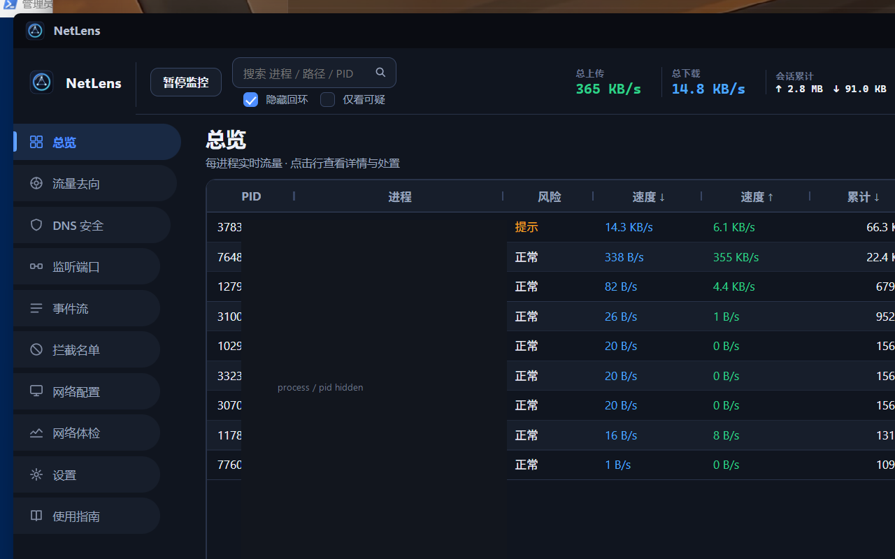
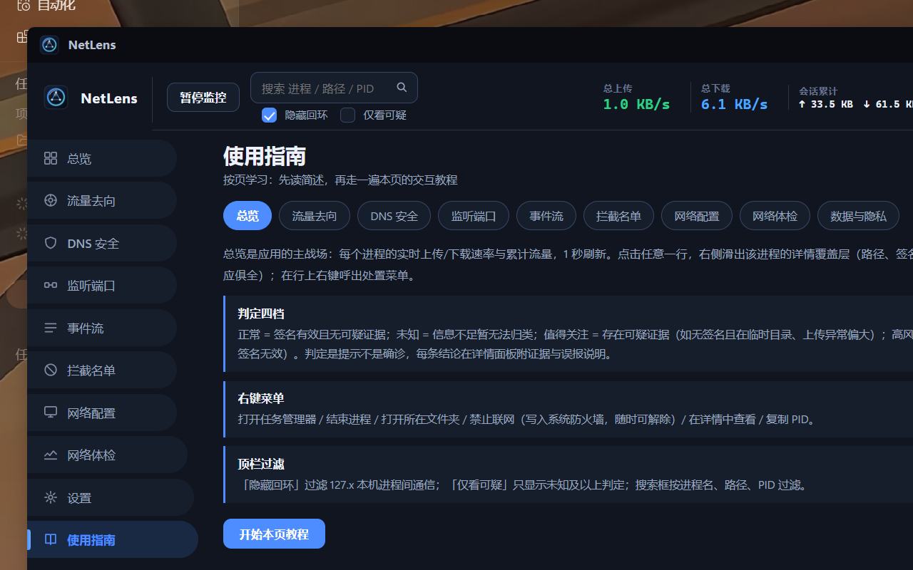
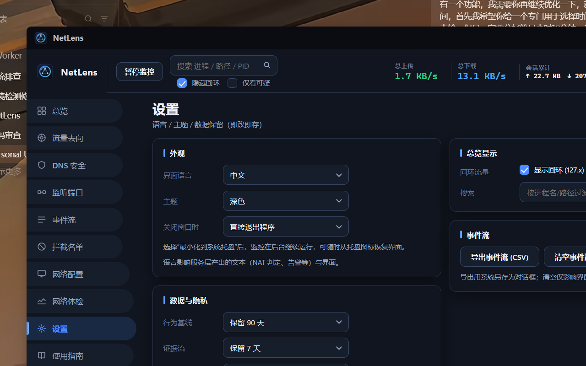

# NetLens

一个 Windows 下的进程级网络监控工具。

> **分支说明**：`main` = 0.1.5 整理版（0.1.4 外观，稳定线）；`alpha/0.1.5` = 全新 WebView2 界面演进分支（**当前主开发线**，本 README 描述的就是它）；`beta/0.1.5-classic` = 0.1.4 外观基线（规划中）。

做这个的起因很简单：我想知道我电脑后台到底有哪些程序在联网、在传什么数据。依靠杀软也大多是处于文件本身层面的追查，任务管理器只给个数字，资源监视器的信息又太散。所以我把它做了出来——把每一条网络行为摊开来看：哪个进程在连、连到哪个 IP 和域名、上传下载了多少、签名有没有问题、被谁拉起来的。看完之后要不要放行、要不要掐掉，试图从更多维度去对本机环境进行安全检查，当然未来也许不仅仅局限在client。

## 界面

### 总览

每进程实时流量、判定分级与处置入口的主战场。点击任意一行，右侧滑出该进程的详情覆盖层。



### 使用指南

内置的按页学习手册：每个功能页一个子标签，功能简述 + 概念解释（判定分级、右键菜单、行为基线、NAT 类型等都用大白话讲清），并提供「开始本页教程」——跳转到真实页面，用聚光气泡一步步走完该页的所有交互。



### 设置

语言、主题、关闭行为与数据保留均即改即存。



## 它能干什么

- **实时流量**：每个进程的上传/下载速率与累计流量，1 秒刷新；顶栏含全局指标与流量曲线
- **连接明细**：每个进程现在连着哪些 IP 和端口，远端自动标注域名（被动 DNS 学习，不外发查询）
- **详情覆盖层**：点击任意进程行，右侧滑出完整档案——路径、厂商与描述、数字签名、父进程、首次出现、完整命令行、软件身份与 SHA256、风险原因与判定证据、承载服务、实时连接、最近 DNS，以及处置按钮组
- **事件流**：连接建立、断开、单次大额传输、防火墙拦截的实时流水；右键可对目标发起 DNS 体检、定位进程、只看此进程的事件；支持导出 CSV
- **DNS 劫持检测**：公网域名解析到内网地址、有程序绕过系统 DNS 自行查询、hosts 和代理被改——都会提示；还有手动 DNS 体检，拿公共 DoH 对比解析结果
- **可疑判定**：正常 / 未知 / 值得关注 / 高风险 四档，由本地证据引擎计算（伪装系统进程名、签名状态、可疑目录、传输行为等），每条结论都附证据、依据和误报说明
- **处置**：右键直接断网（写入 Windows 防火墙规则，随时可解除）、结束进程、打开任务管理器（自动定位到该进程行）、加入信任名单
- **行为基线**：存在本地 SQLite，跨会话记录"这程序以前连过谁"，新面孔一眼就能看出来
- **系统托盘与关闭行为**：常驻托盘图标，左键恢复界面；关闭窗口可询问 / 直接退出 / 最小化到托盘，设置里可改
- **使用指南**：内置按页教程与完整功能手册，新用户零门槛

## 目录结构

```
NetWatch/                     仓库根（项目名沿袭旧名，程序现名 NetLens）
├─ src/NetLens/               C# 主程序（WPF + WebView2 混合，.NET 10）
│  ├─ App.xaml(.cs)           应用入口：单实例/全局异常/数据迁移/托盘创建
│  ├─ MainWindow.xaml(.cs)    classic WPF 界面（main/beta 分支的界面）
│  ├─ SpikeWindow.xaml(.cs)   alpha WebView2 界面窗口（默认启动）
│  ├─ ClosePromptWindow.xaml  关闭确认弹窗（询问模式）
│  ├─ Bridge/                 C# ↔ WebUI 桥：UiBridge(命令路由) + SnapshotBuilder(1s 快照)
│  ├─ ViewModels/             MainViewModel：监控引擎编排
│  ├─ Services/               监控/检测/处置服务层（ETW/DNS/防火墙/网关/设置/托盘/关闭行为/任务管理器定位…）
│  ├─ Native/                 Win32 P/Invoke（路由表/DWM 窗口效果）
│  ├─ Themes/                 WPF 主题与语言资源（Palette/Strings zh-en）
│  ├─ Models/                 数据模型
│  └─ Assets/                 app.ico 等资源
├─ WebUI/                     alpha 前端（Vite + TypeScript + AG Grid）
│  ├─ src/pages/              十个页面（总览/流量去向/DNS 安全/监听端口/事件流/拦截名单/网络配置/网络体检/设置/使用指南）
│  ├─ src/i18n.ts             前端双语词典
│  ├─ src/tour.ts             分页交互教程引擎
│  ├─ src/tour-data.ts        教程步骤与文案（双语）
│  ├─ public/brand.png        应用内 logo（与 app.ico 同源，由 tools/icon 管线生成）
│  └─ dist/                   前端构建产物（npm run build，构建后由 csproj 复制进输出目录）
├─ tools/                     长期开发工具
│  ├─ icon/                   图标生产管线（SVG 源 → resvg 渲染 → ICO 打包 → 同步部署）
│  ├─ gen-icon.ps1            旧版图标生成器（保留）
│  ├─ shot-*.ps1              截图工具族（UI 验收）
│  ├─ sync-to-submit.ps1      同步到 S:\GitSubmitClass 发布目录
│  └─ oneoff/                 一次性补丁/诊断脚本归档（过程记录，勿删）
├─ assets/screenshots/        README 展示截图
├─ build-installer.ps1        打包安装器（Inno Setup，输出 dist/）
├─ publish.ps1                发布产物准备（dotnet publish）
├─ setup.iss                  Inno Setup 脚本
├─ dist/                      安装包输出（gitignore，含历史版本归档）
├─ verify/                    本地验收产物（gitignore）
├─ archive/                   历史文件归档
└─ docs/                      本地文档（gitignore）
```

## 构建与运行

### 程序入口（每次更新后的成品位置）

```
S:\ZWorker\NetWatch\src\NetLens\bin\Debug\net10.0-windows\NetLens.exe
```

直接启动即为 alpha 新界面（总览页）。启动参数：`--spike:页面名` 直达指定页（destinations / dns / ports / events / blocking / network / netcheck / settings / guide）；`--classic` 进入 classic WPF 旧界面。

### 更新流程（改完代码后）

```powershell
# 1. 前端有改动时先构建 dist（WebUI 目录下）
cd WebUI; npm run build

# 2. 杀掉运行中的实例后构建主程序（dist 会随构建复制到 bin 输出目录）
dotnet build src/NetLens

# 3. 运行验证
S:\ZWorker\NetWatch\src\NetLens\bin\Debug\net10.0-windows\NetLens.exe
```

### 发布安装包

```powershell
powershell -ExecutionPolicy Bypass -File build-installer.ps1
```

## 几点说明

- 本工具只看连接和流量，**看不到 HTTPS 里面的内容**，别指望它替你分析加密数据
- 判定只是提示，不是确诊病毒。仅仅是揭示网络痕迹，最终判断仍然要靠你自己。
- 程序自身零联网：没有遥测、没有更新检查、不查 IP 归属地。例外只有两处，皆为主动触发（自己点击）：设置里的"DNS 体检"、网络体检的带宽测速
- 行为基线和证据流都存在本机 `%LOCALAPPDATA%\NetLens`，保留多久可以在设置里调，不想要了随时清
- 浏览器如果开了自带的"安全 DNS"（DoH），会绕过系统解析，DNS 页看不到它的记录——介意的话把浏览器那个开关关掉

## 具体实现

靠 Windows 自带的机制：ETW 内核网络事件（每次收发自带 PID 和字节数）、DNS-Client 提供程序（能看到每个进程查了什么域名）、连接表轮询、服务枚举（svchost 能归因到具体服务，比如 Dnscache）、wintrust 验签名、防火墙 COM 做拦截。界面是 WPF + WebView2 混合：WPF 宿主提供提权/托盘/单实例/模态窗口与窗口壳，WebView2 承载新界面（AG Grid 大表 + TypeScript），C# 侧 Bridge 每秒推送快照、路由命令；图标由 SVG → resvg 的程序化管线生成，从源文件到任务栏全链路一致。
